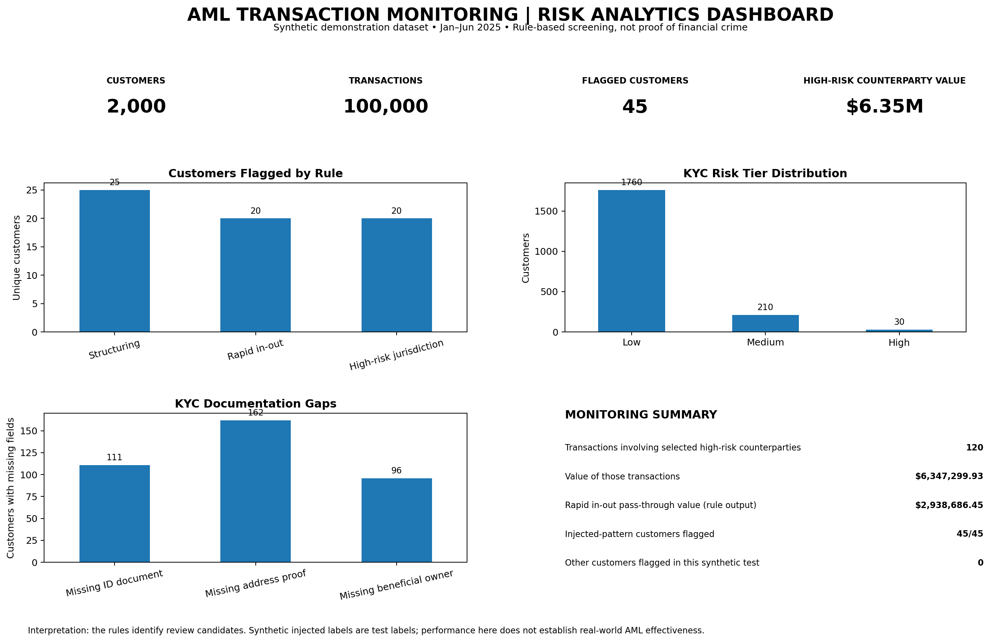

# AML Transaction Monitoring & Risk Analytics

**SQL | Python | Data Analytics | Financial Crime Risk**

## Dashboard Preview




## Overview

This project explores a data-driven approach to Anti-Money Laundering (AML) transaction monitoring using synthetic customer and transaction data. It applies SQL-based screening rules to flag potentially suspicious transaction patterns, examine exposure to higher-risk jurisdictions, and identify gaps in Know Your Customer (KYC) documentation.

The project demonstrates how data analytics can support financial crime risk monitoring, customer due diligence, and the prioritisation of transactions or customers for further review.

**Note:** All data used in this project is synthetic. The results are illustrative and do not represent actual financial transactions or confirmed money laundering activity.

## Objectives

- Identify potential structuring patterns involving repeated deposits just below a specified threshold.
- Analyse transaction exposure to selected higher-risk jurisdictions.
- Assess missing KYC documentation across different customer entity types.
- Generate synthetic customer and transaction datasets for reproducible analysis.
- Demonstrate how SQL-based rules can support risk screening and alert generation.

## Tools & Technologies

- **SQL:** Filtering, joins, aggregation, conditional logic and grouped analysis.
- **Python:** NumPy and pandas for synthetic data generation and data manipulation.
- **CSV:** Storage and exchange of customer, transaction and alert data.

## Dataset

The Python script generates synthetic data containing:

- **2,000 customers**
- **100,000 transactions**
- Customer attributes such as entity type, country, politically exposed person (PEP) status and KYC documentation indicators.
- Transaction attributes such as transaction ID, customer ID, timestamp, amount, transaction direction and counterparty country.
- Injected patterns designed to simulate selected suspicious transaction behaviours.

### Simulated risk patterns

1. **Potential structuring:** Repeated incoming deposits just below a specified threshold within a short period.
2. **Rapid movement of funds:** Alternating incoming and outgoing transactions involving selected higher-risk jurisdictions.
3. **KYC documentation gaps:** Missing identity documents, address proof or beneficial ownership information.

The jurisdiction list and transaction thresholds are configurable assumptions for this demonstration, not universal definitions of financial crime risk.

## SQL Analysis

The SQL queries cover three main analytical areas:

### 1. Structuring Candidates

Identifies customers with at least three incoming deposits between 9,000 and 9,999.99 and ranks them by the number of near-threshold deposits.

### 2. Higher-Risk Jurisdiction Exposure

Joins customer and transaction records to aggregate transaction counts and values by customer country for transactions involving the selected counterparty jurisdictions.

### 3. KYC Documentation Gaps

Summarises missing identity documents, address proof and beneficial ownership information by customer entity type.

These queries are screening rules intended to identify records for further investigation, not to establish wrongdoing.

## Repository Structure

```text
aml-transaction-monitoring/
├── README.md
├── queries.sql
├── generate_data.py
├── data/
│   ├── customers.csv
│   └── transactions.csv
├── alerts/
│   ├── kyc_risk_scores.csv
│   ├── alerts_structuring.csv
│   ├── alerts_rapid_in_out.csv
│   └── alerts_high_risk_jurisdiction.csv
└── screenshots/
    └── dashboard.png
```

